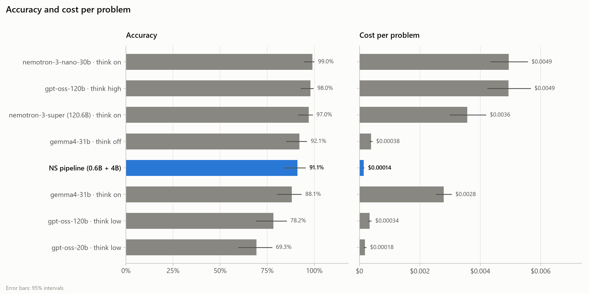
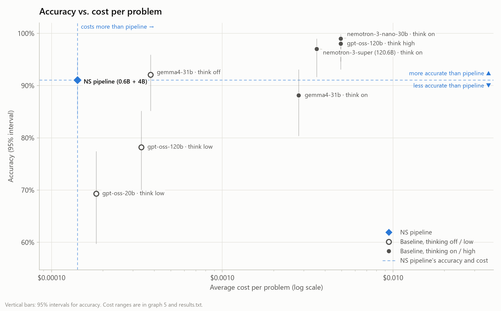
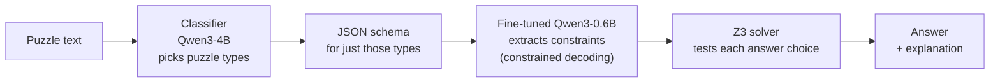
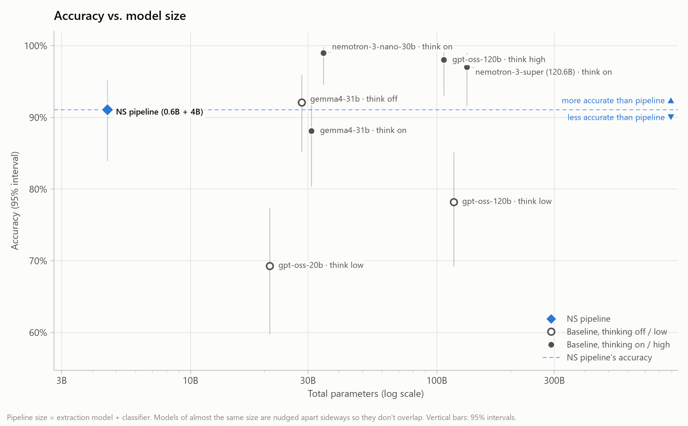
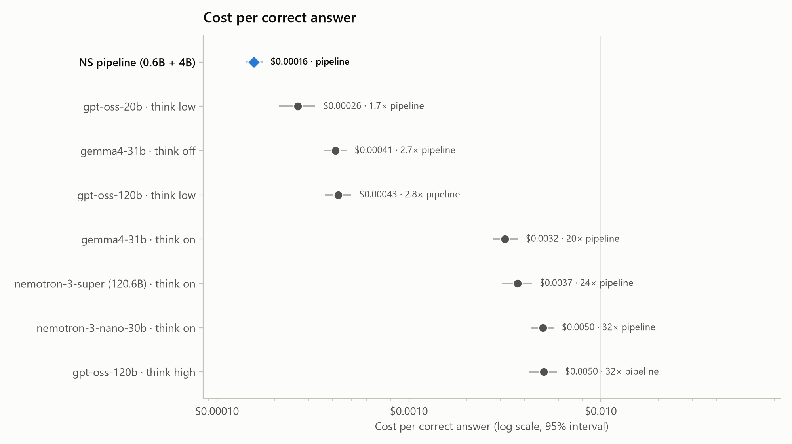
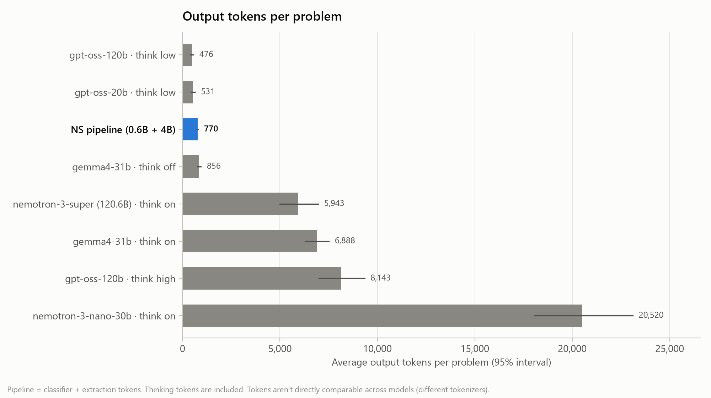

# Neurosymbolic Testing

**A fine-tuned 0.6B extractor + Z3 solver (with a 4B puzzle-type classifier) scores 91.1% on 101 held-out logic puzzles, beating gpt-oss-120b at low reasoning (78.2%, p = 0.004) at 2.8× lower cost per correct answer.**





## Results

101 held-out logic puzzles (ordering, grouping, knights and knaves) from [sft_test.jsonl](logic/data/sft_test.jsonl). The baseline models answer each puzzle directly.

| Model · reasoning | Params (active) | Accuracy | Correct | Avg tokens in / out | Cost / problem | Cost / correct | p vs. pipeline |
|---|---|---|---|---|---|---|---|
| nemotron-3-nano-30b · on | 31.6B (3.2B) | 99.0% | 100 / 101 | 277 / 20,520 | $0.0049 | $0.0050 (32×) | 0.021 |
| gpt-oss-120b · high | 117B (5.1B) | 98.0% | 99 / 101 | 331 / 8,143 | $0.0049 | $0.0050 (32×) | 0.039 |
| nemotron-3-super · on | 120.6B (12.7B) | 97.0% | 98 / 101 | 277 / 5,943 | $0.0036 | $0.0037 (24×) | 0.146 |
| gemma4-31b · off | 31B (dense) | 92.1% | 93 / 101 | 272 / 856 | $0.00038 | $0.00041 (2.7×) | 1.000 |
| **NS pipeline** | **0.6B + 4B** | **91.1%** | **92 / 101** | **639 / 770** | **$0.00014** | **$0.00016** | — |
| gemma4-31b · on | 31B (dense) | 88.1% | 89 / 101 | 270 / 6,888 | $0.0028 | $0.0032 (20×) | 0.629 |
| gpt-oss-120b · low | 117B (5.1B) | 78.2% | 79 / 101 | 331 / 476 | $0.00034 | $0.00043 (2.8×) | 0.004 |
| gpt-oss-20b · low | 21B (3.6B) | 69.3% | 70 / 101 | 331 / 531 | $0.00018 | $0.00026 (1.7×) | <0.001 |

Output tokens include thinking tokens. "Cost / correct" in brackets is the multiple of the pipeline's. The p-value is an exact McNemar test on the same 101 puzzles; below 0.05 means the gap is unlikely to be chance. Full table with 95% intervals: [results.txt](logic/data/plots/results.txt).

**Reading the results**

- **Where the pipeline wins:** it beats gpt-oss-120b (low) and gpt-oss-20b (low), both by a significant margin. It is statistically tied with gemma4-31b, with thinking on or off, at 2.7–20× lower cost per correct answer.
- **Where bigger models win:** with reasoning on high, gpt-oss-120b, nemotron-3-super and nemotron-3-nano reach 97–99%. That takes 6k–21k output tokens per problem (vs. 770) and costs 24–32× more per correct answer.
- **Active parameters:** gpt-oss-120b is a mixture-of-experts model that runs about 5.1B parameters per token, close to the pipeline's 4.6B total. The model doing the hard part of the pipeline, extraction, is 0.6B.
- **Tokens vs. cost:** the pipeline uses more tokens than gpt-oss-120b (low), 1,409 vs. 807 per problem, but those tokens run on much smaller models, so they cost less. Token counts are only roughly comparable across models, since each uses a different tokenizer.

**Caveats**

- **Chance level:** 72 of the 101 puzzles have two answer choices, so random guessing scores about 45%.
- **Test set:** the puzzles come from the same generator as the training data, so they are in-distribution for the fine-tuned model, but none of the 101 were in its training data. The baseline models answer zero-shot.
- **Pipeline cost is estimated:** the pipeline runs locally, so it is priced at public API rates for its base models (Qwen3-0.6B on Fireworks, Qwen3-4B on Nebius). Baselines use Ollama Cloud list prices. All prices: [model_specs.txt](logic/data/plots/model_specs.txt).

## Why these puzzles

The three puzzle types are modeled on the logic games in the LSAT's Analytical Reasoning section, which tests deduction from a fixed set of rules:

- **Ordering:** place people in positions from clues like "Amy is before Olga." This is the LSAT's sequencing game.
- **Grouping:** assign people to groups under inclusion and exclusion rules. This is the LSAT's other main game type.
- **Knights and knaves:** truth-tellers and liars whose statements constrain each other. This classic puzzle adds conditional and self-referential logic.

74 of the 101 test puzzles combine two or three types. Each puzzle has one provably correct answer, and the answer choices take the LSAT's form ("must be true", "could be false"). The puzzles take careful multi-step reasoning for an LLM, but Z3 can check every answer exactly.

## How it works



The language model only translates the puzzle into structured constraints, and Z3 does the reasoning. Constrained decoding against a schema narrowed to the puzzle's types limits what the model can get wrong, which is what makes 0.6B enough. Details: [logic/README.md](logic/README.md).

The fine-tuned 0.6B model's weights are not uploaded to GitHub (see [Reproduce the results](#reproduce-the-results)).

## More graphs

Accuracy vs. total model size:



Cost per correct answer, as a multiple of the pipeline's:



Output tokens per problem, thinking included:



## Reproduce the results

> **The fine-tuned model is not on GitHub.** The `SFT_Extraction_Qwen3_0.6b-v4` weights (~610 MB) are excluded from this repo. A fresh clone can rerun the baselines and rebuild every graph and table from the saved results in [logic/data/demo_runs/](logic/data/demo_runs/). To rerun the pipeline itself, you first need to retrain the model with [NS_training.ipynb](logic/pipeline/NS_training.ipynb).

Requires Python 3.12.

```
pip install -r requirements.txt
cd logic/pipeline
python run.py            # once per setup; settings are constants at the top
python plot_results.py   # graphs and tables -> logic/data/plots/
```

- In [run.py](logic/pipeline/run.py), set `MODEL_SETS` for the pipeline run, or `RUN_BASELINE = True` with one entry in `BASELINE_MODELS` for each baseline run. Each setup writes one file to [logic/data/demo_runs/](logic/data/demo_runs/). With `RESUME = True`, a stopped run picks up where it left off.
- Baselines run on Ollama Cloud.

## Repo layout

| Folder | Problem | Status |
|---|---|---|
| [logic/](logic/README.md) | Logic puzzles (ordering, knights and knaves, grouping) | The main project: fine-tuned extractor, Z3 solver, explanation engine, and the benchmark above |
| [math/](math/README.md) | Arithmetic word problems | The original prototype |
